# LangLang - Language School Management System

LangLang is a **team university project** created for the **Introduction to Software Engineering** (*Uvod u softversko inženjerstvo*) course. It is a language school management system developed in **C# and .NET**, with a **WPF desktop application** and a separate **reflection-based console CRUD application**.

The project was an opportunity to learn C# and apply software engineering principles to a larger application: organizing code into models, data access, controllers, services, validation, and user interfaces, while working together as a team. **Functionality and software structure were the main priorities; visual UI design was not the focus.**

**[Watch the project demonstration on YouTube](https://youtu.be/ETPUtNYVzwo)** - selected workflows from both applications are shown; the video is not an exhaustive walkthrough.

[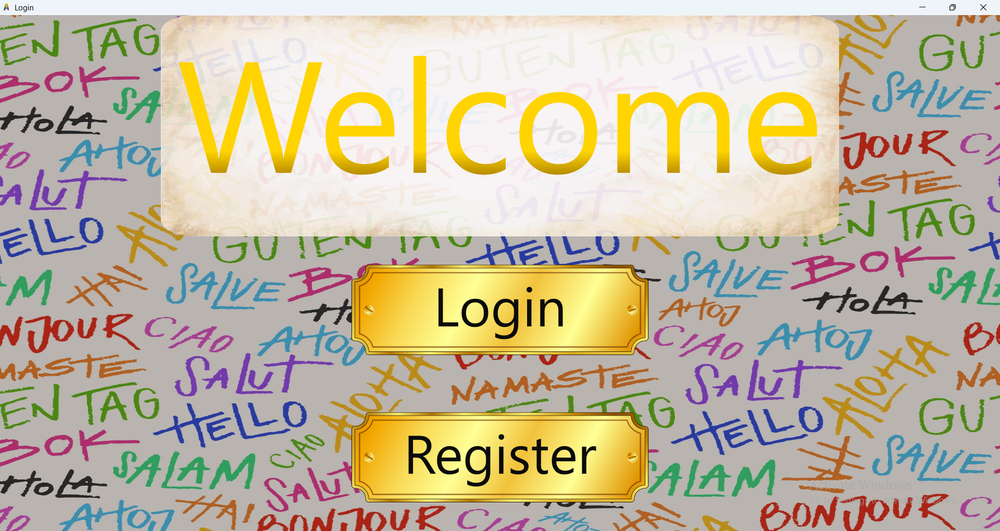](https://youtu.be/ETPUtNYVzwo)

## What is included?

The solution contains two applications that work with the same domain models and underlying data:

- **LangLang (WPF):** a desktop interface for students, professors, and the school principal, with different permissions and workflows for each role.
- **ConsoleCRUD:** a separate, generic console interface for browsing and managing application data. Rather than hard-coding a menu for every model, it uses **C# Reflection** to discover types, inspect their properties, and connect them with data-access operations.

## WPF application - features

### Authentication and student accounts

- Student registration and login, with input validation.
- Role-based login for students, professors, and the principal.
- Student profile viewing, editing, and deletion.
- Internal inbox and messages, including read/unread management and notifications.

### Student

- Browse available courses and exam terms, with **search filters, sorting, and pagination**.
- Submit and cancel course enrollment requests, subject to the application's scheduling rules.
- View pending requests, an active course, and completed courses.
- Apply for eligible language exams and follow requested, active, and completed exams.
- Receive messages about enrollments, results, and penalty points.

### Professor

- Create, edit, and remove courses and exam terms, with date and scheduling validation.
- Manage teaching activities, including starting courses and exams and completing them.
- Review course enrollment and withdrawal requests.
- Grade students in courses and record results for the four exam components: **reading, writing, listening, and speaking**.
- Manage student penalty points and communicate through the internal messaging system.

### Principal

- Manage professor accounts (add, edit, delete).
- **Reassign ongoing courses** when removing a professor, choosing qualified replacements while accounting for schedule conflicts.
- Browse courses and exam terms and oversee teaching activities.
- Generate four kinds of **PDF reports**:
  - Penalty points
  - Average grades
  - Statistics by language
  - Exam results
- Send generated PDFs as email attachments using a **local SMTP test server**.

## Console CRUD application

The separate `ConsoleCRUD` project provides a data-management interface for the application's entities. It is not simply a static console menu: it uses **Reflection** to examine application models at runtime and to build reusable operations around them.

Features include:

- Discovering model classes and resolving their corresponding DAO operations.
- **Create, Read, Update, and Delete** operations for supported entities.
- Generic, paginated table views and detailed views of individual objects.
- Displaying property names and types, including nested objects, lists, dictionaries, and enum values.
- Handling input for simple and more complex model properties.
- Configurable console presentation themes and table styles.

This was a particularly useful part of the project for exploring **runtime type inspection, generics, reflection, and reusable code**.

## Technologies and project structure

| Area | Technology / approach |
| --- | --- |
| Language and runtime | C#, .NET 8 |
| Desktop interface | WPF / XAML |
| Console interface | .NET console application, Reflection |
| Data access | DAO classes, JSON files, and SQLite / Entity Framework Core for selected data |
| PDF reports | QuestPDF |
| Email delivery | MailKit / SMTP (configured for local testing) |
| Application organization | Models, DTOs, controllers, services, validation, and data-access layers |

```text
WPF-Language-School-Management/
├── LangLang/                  # WPF application
│   ├── Controller/            # Application services and use-case logic
│   ├── DTO/                   # Data transfer objects and validators
│   ├── Model/                 # Domain models and DAO classes
│   ├── SQL/                   # SQLite / EF Core integration
│   ├── Storage/               # JSON serialization and persistence
│   ├── View/                  # Role-based windows and UI modules
│   └── Data/                  # Sample data
├── ConsoleCRUD/               # Reflection-based console application
│   ├── Services/             # Type discovery, CRUD resolution, parsers
│   └── View/                 # Tables, details, menus, console styling
├── docs/images/               # Screenshots below
└── LangLang.sln
```

## Screenshots

The following screenshots show examples of the applications, **not every available feature**. Some screenshots deliberately have an *Add* dialog or a navigation menu open to show the relevant controls; those dialogs are not displayed by default.

<details>
<summary><strong>Authentication and student interface (5 additional screenshots)</strong></summary>

| Registration | Student dashboard with Courses menu open |
| --- | --- |
| 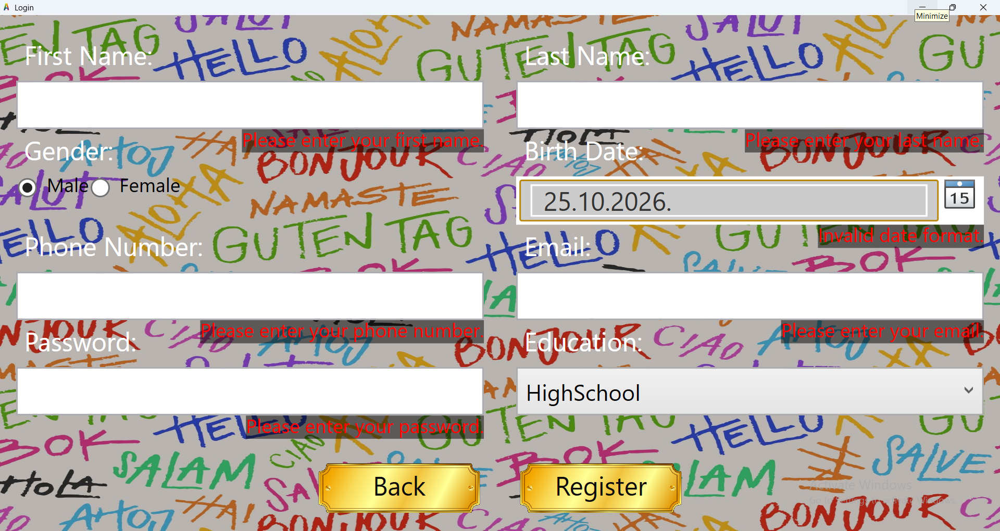 | 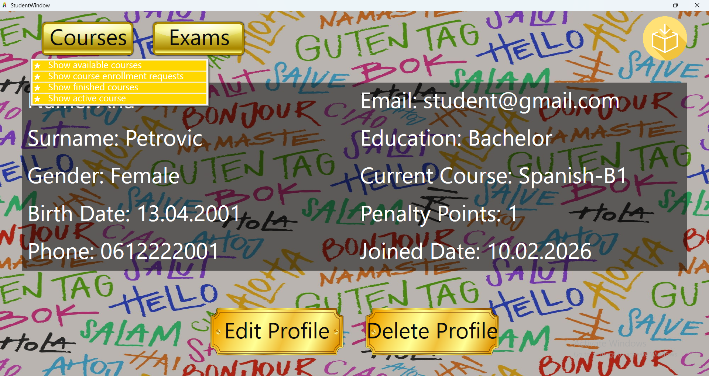 |

| Course browsing and filters | Message inbox |
| --- | --- |
| 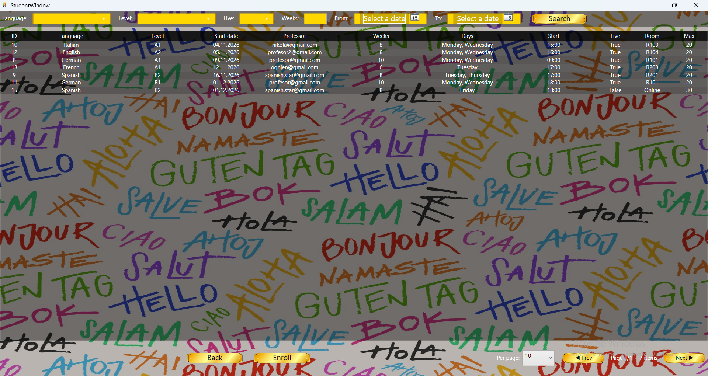 | 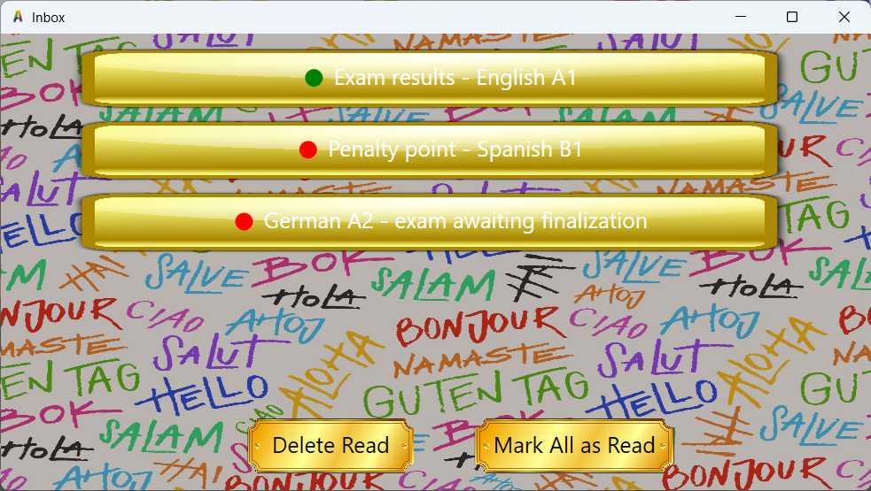 |

| Opened message |
| --- |
| 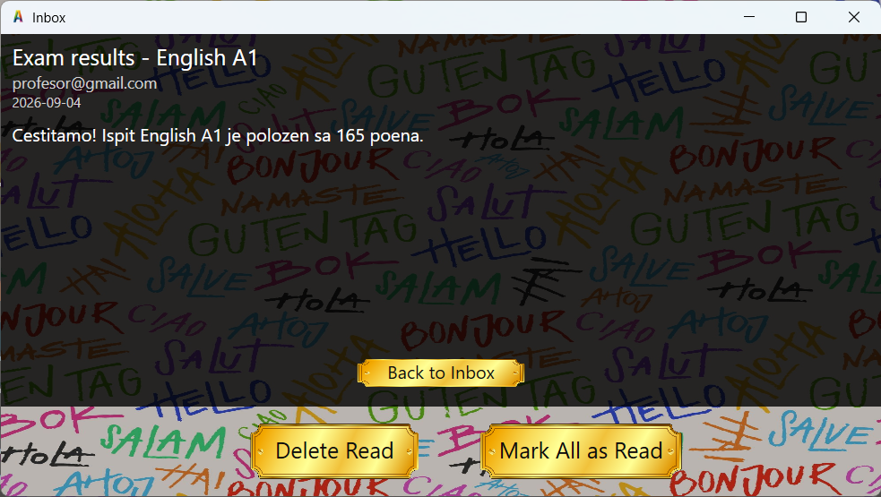 |

</details>

<details>
<summary><strong>Professor interface (3 screenshots)</strong></summary>

| Professor dashboard | Course management - Add Course dialog |
| --- | --- |
| 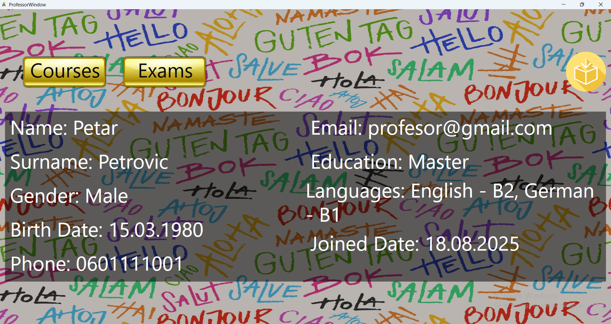 | 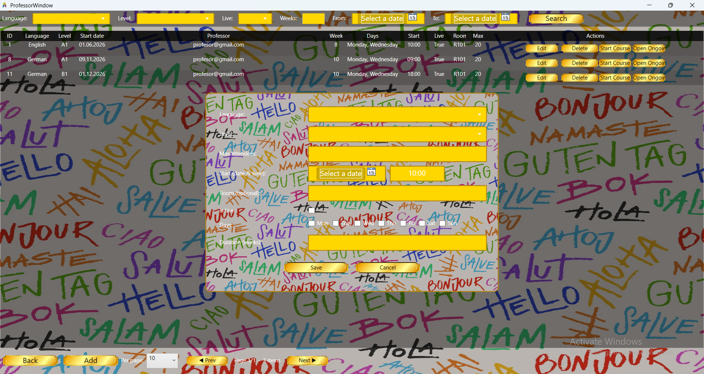 |

| Exam management - Add Exam dialog |
| --- |
| 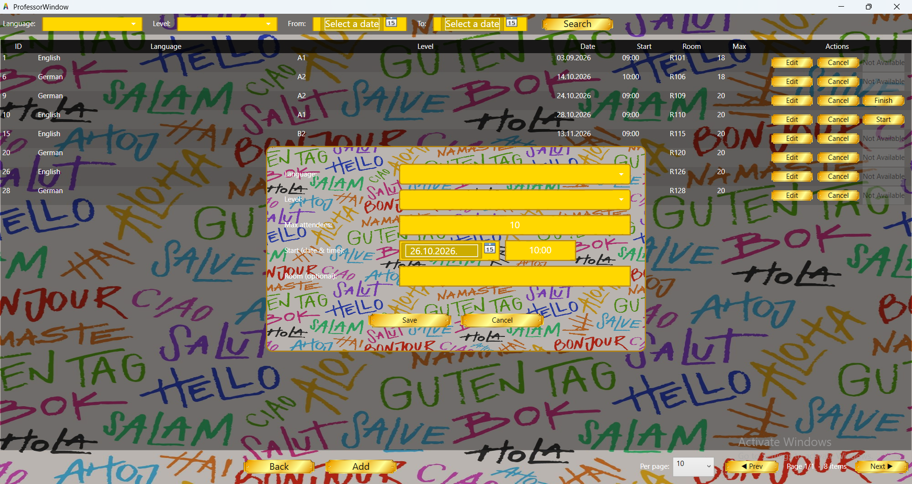 |

</details>

<details>
<summary><strong>Principal interface and reports (3 screenshots)</strong></summary>

| Professor management - Add Professor dialog | Available report types |
| --- | --- |
| 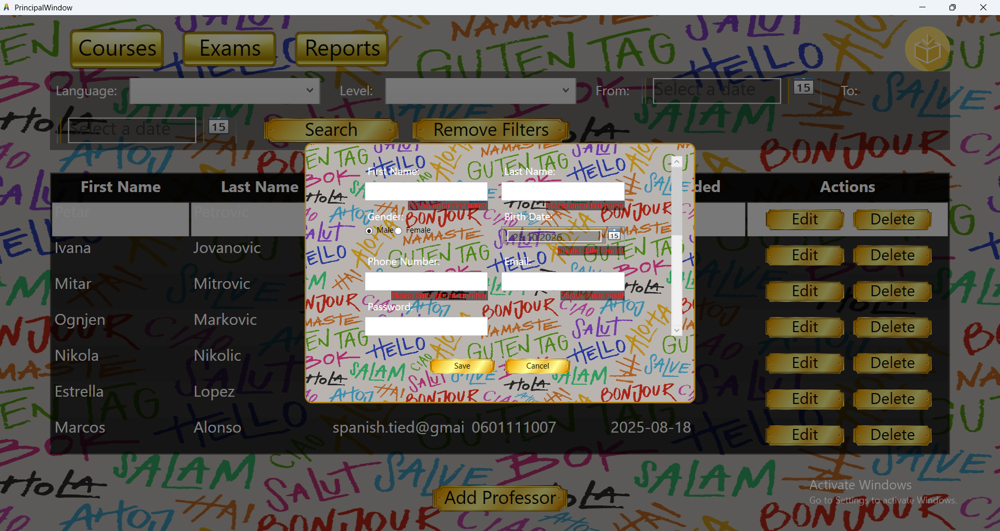 | 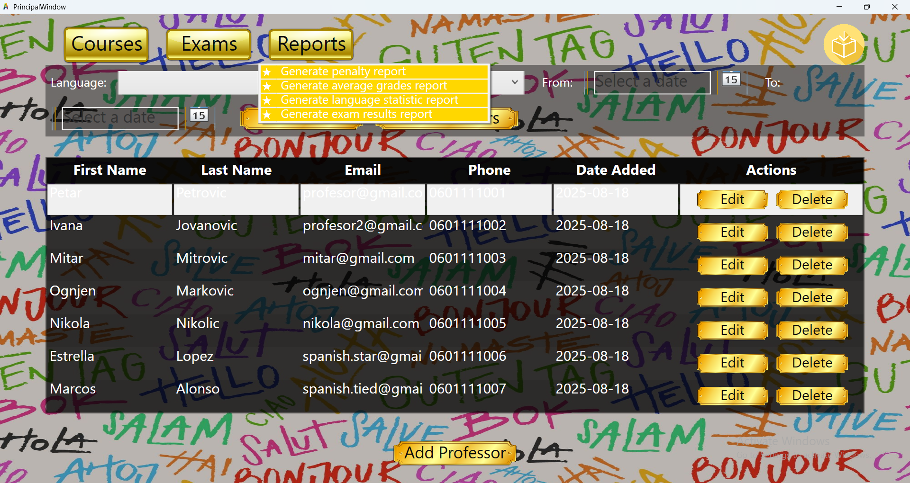 |

| Example of a generated PDF report |
| --- |
| 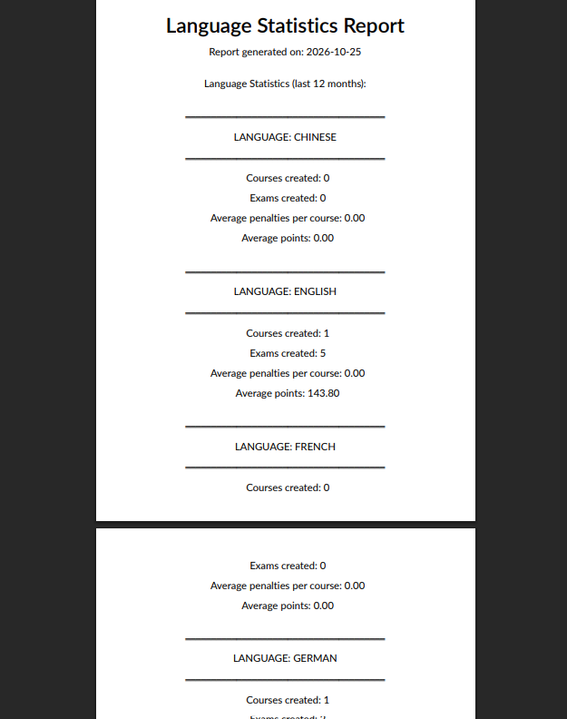 |

</details>

<details>
<summary><strong>Console CRUD and Reflection (4 screenshots)</strong></summary>

| Entity selection | CRUD operations |
| --- | --- |
| 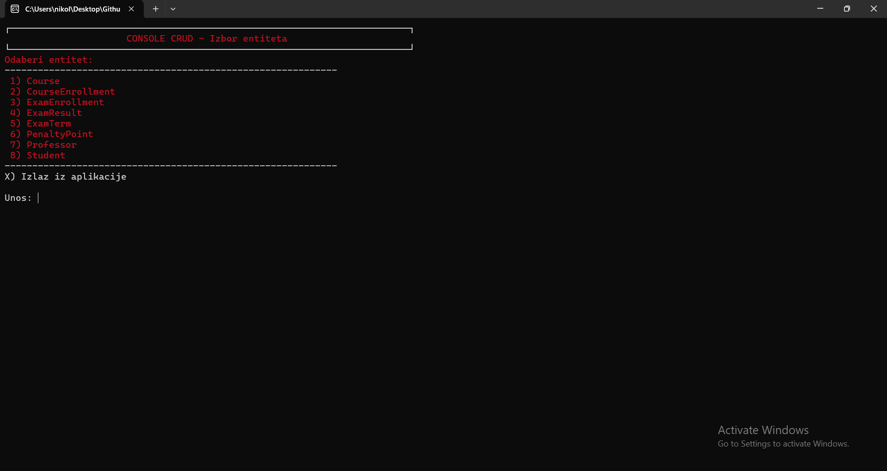 | 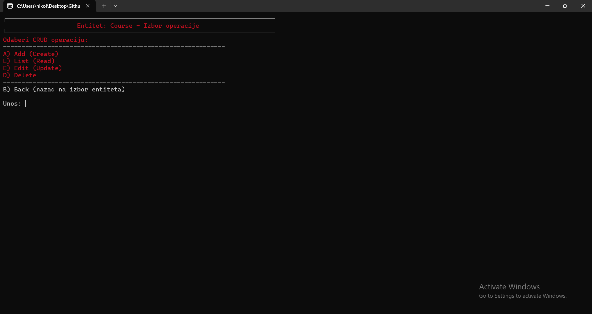 |

| Generic table of courses | Detailed object inspection |
| --- | --- |
| 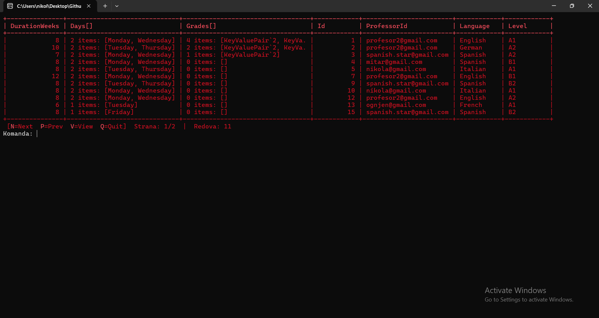 | 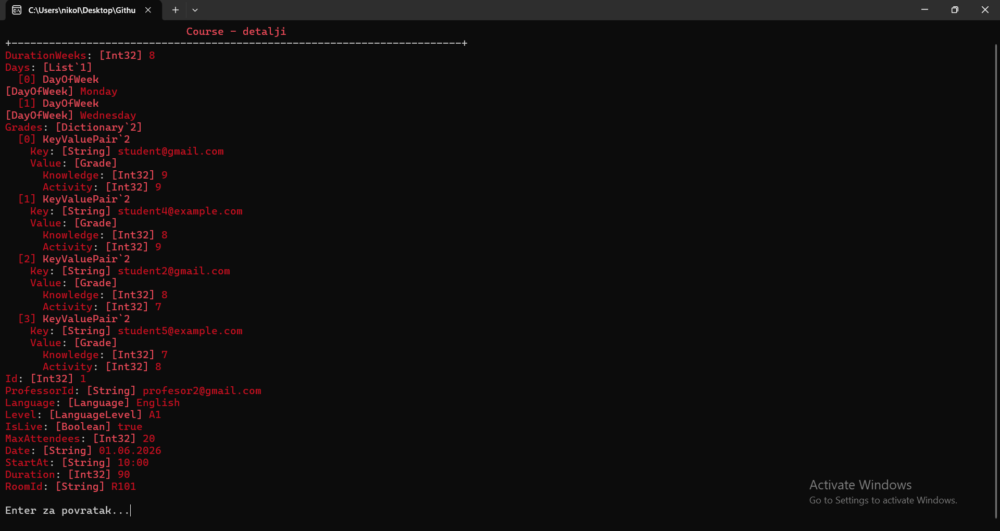 |

</details>

## Running the project

**Requirements:** Windows, Visual Studio with the **.NET desktop development** workload, and the **.NET 8 SDK**.

1. Clone the repository and open `LangLang.sln` in Visual Studio.
2. Restore NuGet dependencies and build the solution.
3. Choose **LangLang** as the startup project to launch the WPF application, or **ConsoleCRUD** to run the console application.
4. The project includes example JSON data in `LangLang/Data` for exploring the workflows. Keep the expected data folder structure intact.

**Important:** The JSON storage code uses a relative file path, so launching an executable with a different working directory may cause file-loading issues. The SQLite database (`langlang.db`) is created locally when needed and is separate from the sample JSON files.

### Testing PDF report email delivery

Report emails are configured for a **local SMTP server at `localhost:1025`**, not for a real Gmail SMTP account. To inspect emailed PDF reports, run a local email catcher such as [Mailpit](https://github.com/axllent/mailpit) and open its web UI (by default `http://localhost:8025`). The principal reports are attached to messages addressed to the configured test recipient.

## Team

Developed as a team project for **Introduction to Software Engineering**:

- **Nikola Savić** - SV34/2023
- **Lazar Vilotić** - SV51/2023
- **Uroš Milinović** - SV55/2023
- **Ognjen Vujović** - SV49/2023

## Project context

LangLang was built as a **learning project**, not as a production-ready school platform. The emphasis was on learning C#, structuring an application, implementing business logic, handling different user roles, and exploring techniques such as Reflection in a separate console tool. The UI reflects that priority: it is functional, but visual polish was not the primary goal.

The [demo video](https://youtu.be/ETPUtNYVzwo) covers a selection of the implemented workflows in both applications.
